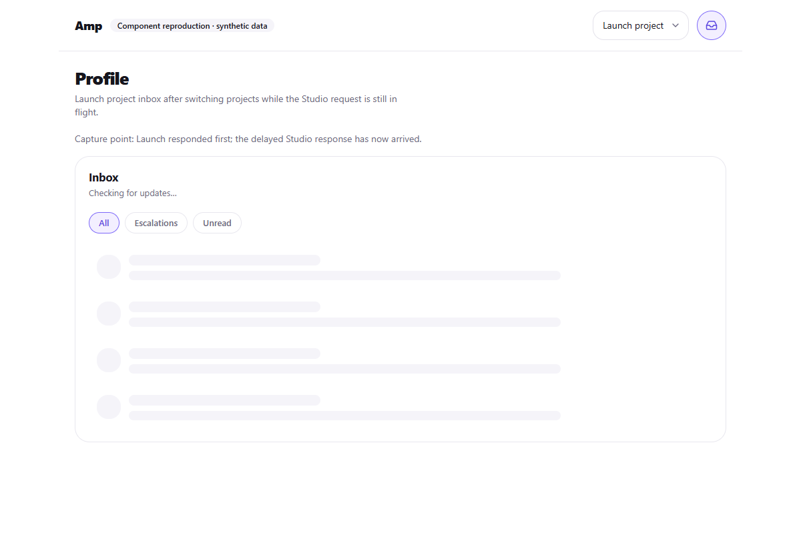
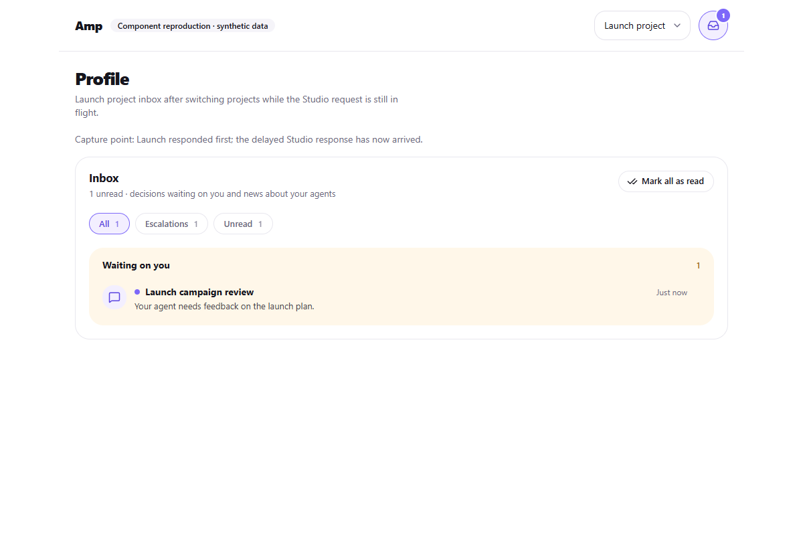

# PR: fix: preserve the current inbox when project requests finish late

When a notification request from project A finishes after switching to project B, it can replace the shared inbox state with project A's response. Project B then displays loading placeholders and loses its unread badge until a later refresh. Late failures and mark-as-read responses can also affect the active inbox.

Keep the shared store scoped to the active project, bind every request to its project's header, and discard superseded responses. Invalidate requests on every project switch, including A → B → A. Notify the badge and inbox subscribers when the project changes.

## Before and after

The screenshots render the existing `InboxTab` and `InboxMenu` components with the app's styles, system font fallbacks, synthetic notifications, and a fixture project provider. Requests are intercepted in the browser: Studio takes 2.2 seconds, Launch responds first, and the screenshot is captured after Studio's old response arrives. The before capture uses the original hook; the after capture uses the updated hook and store. This is an isolated component reproduction, not a screenshot of production data.

| Before: Launch gets stuck loading | After: Launch notifications and badge remain visible |
| --- | --- |
|  |  |

## Validation

- `npx tsx --test src/lib/__tests__/notifications-store.test.ts`
- `npx tsc --noEmit`
- Browser assertions confirm that the old hook loses the Launch notification after Studio responds; the updated hook retains the notification and unread badge.

To reproduce manually, delay project A's `/api/notifications` response, switch to project B, let B's request finish, then release A's response. B's inbox and unread count should remain intact. Repeat with A → B → A and with a pending mark-as-read action.

No migrations, new project dependencies, or environment variables.
