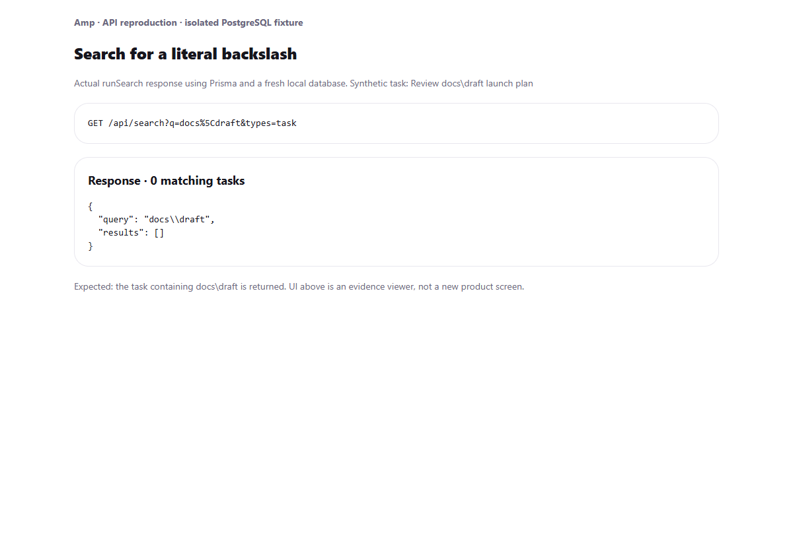
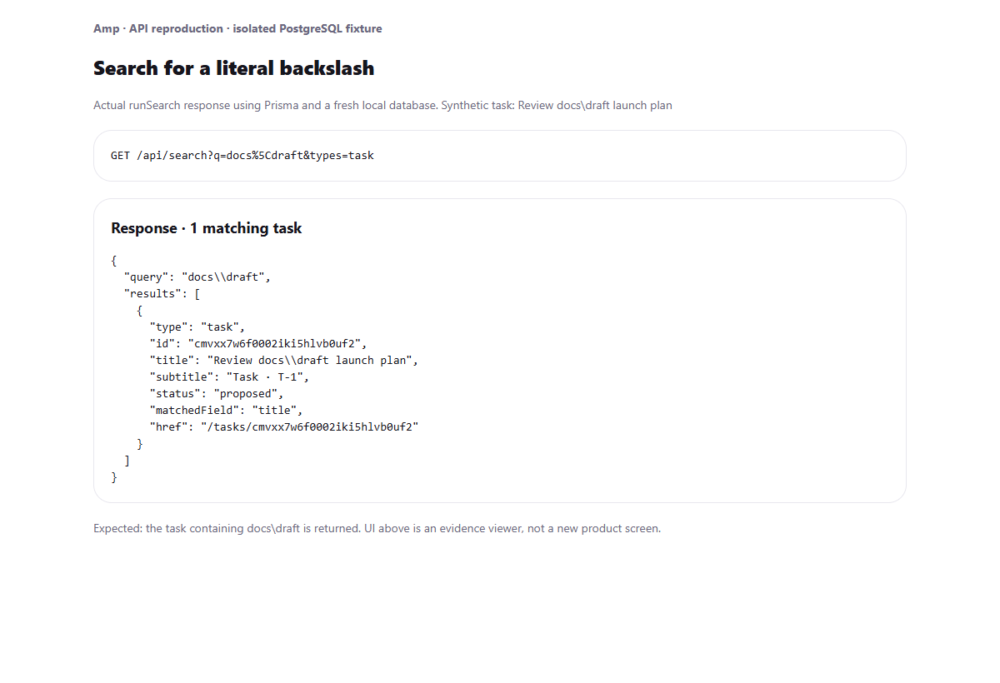

# PR: fix: match backslashes literally in search

Searching for `docs\draft` can miss a task titled `Review docs\draft launch plan`. PostgreSQL treats the unescaped backslash as a LIKE escape character. Escape backslashes along with `%` and `_` so task and agent searches use the literal query.

## Before and after

The screenshots show real `runSearch` responses using Prisma and a fresh local PostgreSQL database with synthetic data. The evidence viewer displays the response; it is not a new app screen. Both captures use the same task and query. The before capture runs the helper from the branch's base commit; the after capture runs the updated helper. The isolated viewer uses system font fallbacks.

| Before: matching task missing | After: matching task returned |
| --- | --- |
|  |  |

## Validation

- `npx tsx --test src/lib/search/__tests__/match.test.ts src/lib/search/__tests__/search.test.ts`
- `npx tsc --noEmit`
- Browser capture asserts zero matching tasks before the fix and one matching task after it against isolated PostgreSQL.

To reproduce manually in a development fixture, create a task containing `docs\draft` and request `/api/search?q=docs%5Cdraft&types=task` using a signed-in session and the project's `x-project-id` header. The task should be returned. Also check queries containing `%`, `_`, and trailing backslashes.

No migrations, new project dependencies, or environment variables.
